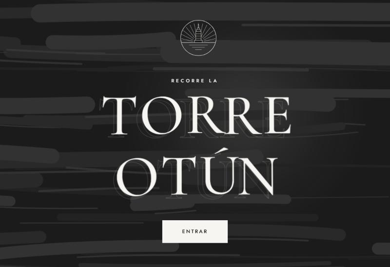
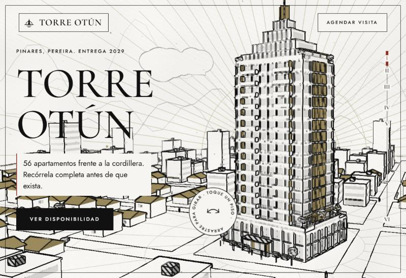
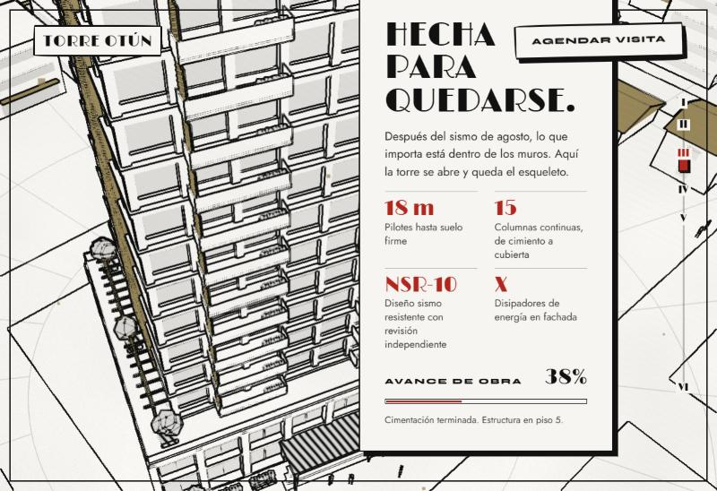
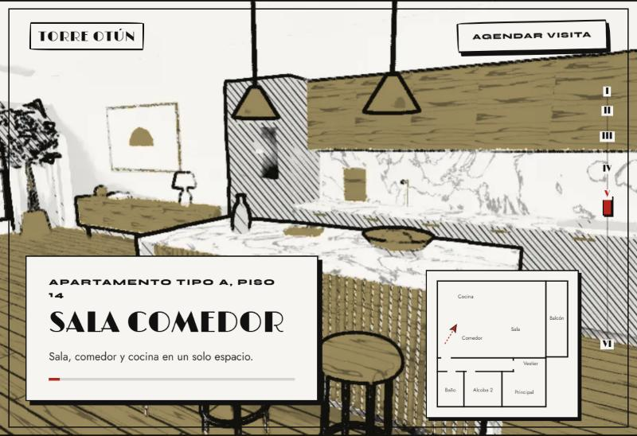

# Torre Otún

Sala de ventas viva para un edificio que todavía no existe: recórrelo por fuera, ábrelo hasta el esqueleto, elige apartamento y camínalo por dentro. Todo dibujado a tinta, como lámina de arquitectura.

**[torre-otun.vercel.app](https://torre-otun.vercel.app)**



| | |
|---|---|
|  |  |



## Qué hace

- **Portada que responde.** El emblema se dibuja al ritmo real de la carga. Después el título aparece por franjas mientras cada letra sube, sobre pinceladas que fluyen en tres profundidades. Título, letras, luz y botón siguen al cursor.
- **Torre en 3D dibujada en vivo.** Un pase de tinta convierte la escena de three.js en grabado: contornos por profundidad y normales, aguada gris, trama solo en sombra fuerte y un único color plano.
- **Se puede tocar.** Arrastra la torre para girarla. Toca un piso y se encienden sus ventanas. Al pasar el cursor, cada piso dice cuántos apartamentos tiene libres.
- **Estructura a la vista.** La torre se desarma piso a piso de arriba hacia abajo y deja ver columnas, núcleo de muros, disipadores y pilotes, con anotaciones técnicas.
- **Disponibilidad y cotizador.** Modo exploración con cada apartamento pintado por estado, ficha con plano, precio y un cotizador de cuota inicial y plazo.
- **Recorrido interior en vivo.** El apartamento es 3D real, no un video: entras por la puerta y pasas por cocina, sala, balcón, pasillo, baño y alcobas. Se reproduce solo, se puede pausar, saltar de espacio, arrastrar la línea de avance y mirar alrededor. Un minimapa marca dónde vas.
- **Barrio con sentido.** Casas con techo a dos aguas, edificios bajos con locales, calles, árboles y personas a escala.
- **Barra de avance propia.** Los capítulos son paradas; se puede hacer clic o arrastrar.
- **Carga liviana y para cualquier equipo.** Todo el 3D pesa 1.5 MB (modelos comprimidos con meshopt). Solo usa texturas de 8 bits, así corre en móviles y Safari, y la resolución baja sola un escalón si el equipo no sostiene el ritmo.
- Respeta `prefers-reduced-motion`.

## Cómo está hecho

**Exterior, en tiempo real.** La escena se dibuja dos veces por cuadro: una con luz y otra que guarda normales y profundidad. Un sombreador las combina en papel, tinta, trama y color plano, y las líneas vectoriales se pintan encima respetando la profundidad. Está en [`src/ink.js`](src/ink.js) y documentado en [`docs/estilo-tinta.md`](docs/estilo-tinta.md) para reutilizarlo en otros proyectos.

**Interior, también en tiempo real.** El apartamento se modela por script en Blender ([`blender/apartamento.py`](blender/apartamento.py)) y se exporta a glTF junto con el camino de la cámara. En el navegador ([`src/apartment.js`](src/apartment.js)) recibe luz, sombra del sol y los trazos de cada material (vetas, juntas de piso y baldosa, pliegues de tela), dibujados por sombreador con ancho constante en pantalla: el trazo queda definido a cualquier resolución.

**Torre y barrio.** [`blender/torre.py`](blender/torre.py) genera el piso tipo, el podio, la corona y el barrio, y los exporta a glTF.

## Desarrollo

```bash
npm install
npm run dev
```

```bash
npm run build
```

Para regenerar el arte hace falta Blender 4 o superior:

```bash
blender --background --factory-startup --python blender/torre.py -- public/models
```

```bash
blender --background --factory-startup --python blender/apartamento.py -- glb CYCLES 0 0 0 public/models
```

Vite, three.js, GSAP y Lenis, sin framework. Tipografías [Cormorant Garamond](https://fonts.google.com/specimen/Cormorant+Garamond) y [Jost](https://fonts.google.com/specimen/Jost).

Proyecto ficticio. Cifras, tiempos y precios son ilustrativos.

---

Diseño y desarrollo por [Juan Ordóñez](https://juanordonezvercelapp.vercel.app).
